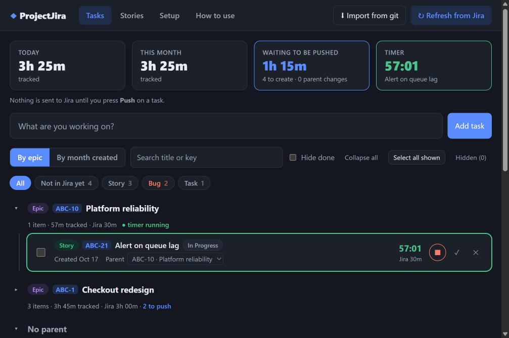
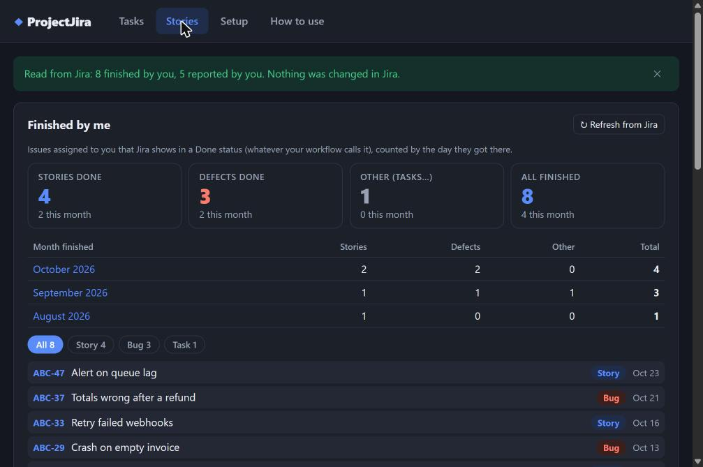
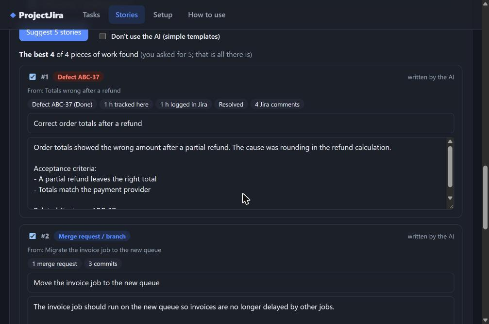
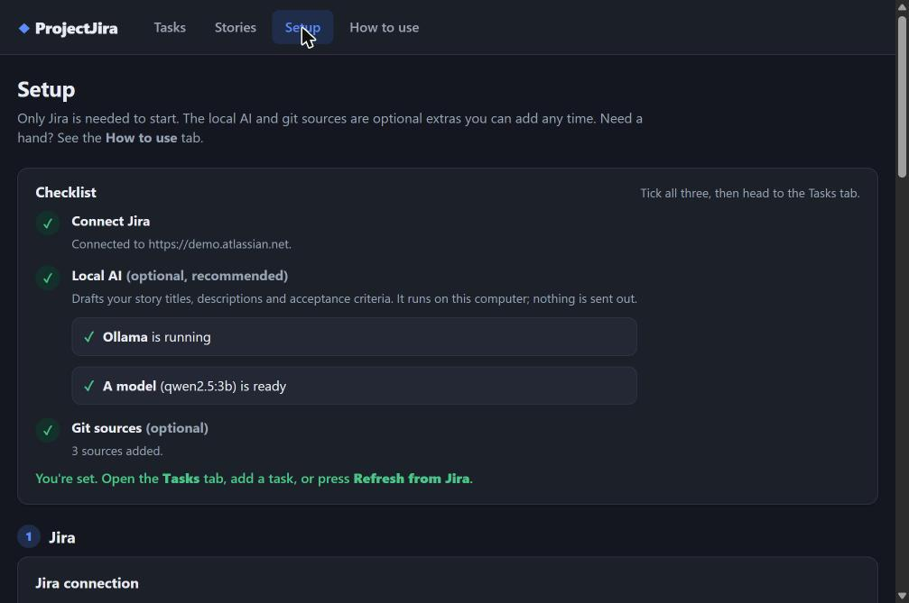

# ProjectJira

Capture what you work on, time it, and turn it into **Jira stories and worklogs** (only when you say so).
A small desktop app for Windows and Linux. The AI that helps write stories runs **on your own computer**.

> The screenshots below use made-up sample data.



## What it does
- **Tasks and timer.** Type what you are working on, press ▶. One timer runs at a time and survives a crash.
- **Jira, read freely, write deliberately.** Refresh pulls your assigned issues (defects included) under their
  epics. **Nothing is written to Jira until you confirm a Push dialog.**
- **Push in bulk.** Select many tasks, choose the project once, review the table, confirm. Each task succeeds
  or fails on its own and is never pushed twice.
- **Work from git.** Import your GitLab merge requests (several servers, one token each) and local repository
  branches as tasks. Any git host works through local repositories.
- **Stories written for you, locally.** A small model through [Ollama](https://ollama.com) drafts a title,
  description and acceptance criteria from a task, merge request or Jira discussion. No cloud AI, ever. Without
  Ollama the app offers simple templates.
- **How much have I finished?** The Stories tab counts the stories and defects you moved to Done, month by
  month, with the list, plus how many stories you created.
- **"I need N stories".** Tell it how many; it picks the N pieces of work that most deserve a story and shows
  why.







## Install
Download the file for your system from the **Releases** page. Each release lists `SHA256SUMS` and, when signed,
a GPG signature; check a download with `sha256sum -c SHA256SUMS --ignore-missing`.

**Ubuntu / Debian** (22.04 or newer):
```bash
sudo apt install ./ProjectJira_<version>_amd64.deb
```
**Windows:** run the `.exe` or `.msi` installer from the release. Until the installers are signed with a
certificate, Windows may show a SmartScreen warning, and PCs with *Smart App Control* switched on will refuse
them; the release notes say whether a build is signed.

**Local AI (optional):** install Ollama from ollama.com, then use **Setup → Local AI** in the app. The app starts
Ollama when it opens and stops it when you close the app.

On first run the Setup tab asks for your Jira site, your Atlassian email and an
[API token](https://id.atlassian.com/manage-profile/security/api-tokens).

## Privacy and security
- Tasks, time and drafts stay in one database file on your computer.
- Tokens go in your system keychain (or a file only you can read where there is none).
- The app talks only to **your** Jira site, **your** GitLab servers (read-only) and Ollama on this computer.
  There is no telemetry and no account.
- A strict content-security policy, links opened only on your own servers, pinned and audited dependencies.
- Found a vulnerability? Please use the repository's **Security → Report a vulnerability** form rather than a
  public issue.

## Build from source
Needs Rust, Node 22, git and, on Linux, the Tauri libraries:
```bash
sudo apt install -y libwebkit2gtk-4.1-dev libgtk-3-dev libsoup-3.0-dev libayatana-appindicator3-dev \
  librsvg2-dev libssl-dev libxdo-dev build-essential pkg-config
```
```bash
npm install
npm run tauri dev                          # run while developing
scripts/test.sh                            # type check, tests, build
npm run tauri build -- --bundles deb       # Linux package
```
Built with [Tauri 2](https://tauri.app) (Rust) and Svelte 5 + TypeScript, SQLite for storage. Windows installers
and signing are built by the GitHub Actions workflow in `.github/workflows/release.yml`.

## License
[MIT](LICENSE)
